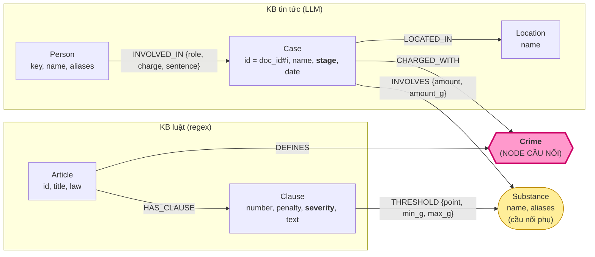

# Thiết kế Ontology — Day 19

**Họ tên:** Bùi Đức Vinh  **MSSV:** 2A202602801

**Lựa chọn** (đánh dấu một):
- [ ] Dùng ontology gợi ý (có thể chỉnh nhỏ)
- [x] Tự thiết kế (xét bonus +15, xem `SUBMISSION.md`)

> Code nằm ở `src/graph.py`, mục `Own ontology` (`parse_law_article_own`, `extract_news_cases_own`, `Neo4jGraph.own_constraints / add_law_article_own / add_news_case_own / context`).
> Ontology gợi ý vẫn được giữ để đối chứng: đặt `KG_ONTOLOGY=hint` thì `build_graph` và `context` chạy theo ontology gợi ý. Kết quả đối chứng nằm ở `ket_qua_benchmark_kg.hint.txt`.

## 1. Sơ đồ

Đường xuyên 2 KB chính: `Person → Case → Crime ← Article → Clause`.
Đường định lượng (chọn đúng khoản theo khối lượng): `Case -[INVOLVES amount_g]→ Substance ←[THRESHOLD min_g..max_g]- Clause`.

## 2. Entity types (node labels)

Số lượng lấy từ graph sau lần chạy `--judge` cuối cùng (ảnh `report/img/kg_count.png`).

| Label | Ý nghĩa | Khóa định danh (`MERGE` theo) | Properties | Lấy từ KB nào | Trích bằng (regex / LLM / khác) |
| --- | --- | --- | --- | --- | --- |
| `Article` (18) | Một điều luật (BLHS Điều 247–259, Luật PCMT 2021) | `id`, ví dụ `"Điều 251 BLHS"` | `title, law, doc_id` | Luật | regex (`parse_law_article`) |
| `Clause` (99) | Một khoản của điều luật | `id` = `"<article id> khoản <n>"` | `number, penalty, severity, text, doc_id` | Luật | regex. `severity` = số năm tù tối đa (tử hình = 40, chung thân = 30, không có tù = 0) do `penalty_severity` tính |
| `Crime` (13) | Tội danh, ví dụ "mua bán trái phép chất ma túy" | `name` (chữ thường) | `name, doc_id` | Luật (tạo ra); tin tức chỉ nối vào | regex trên tiêu đề điều luật |
| `Substance` (12) | Loại chất ma túy **chuẩn hóa** | `name` (tên chuẩn) | `name, aliases` (ví dụ MDMA ← thuốc lắc, ecstasy; "kẹo" = MDMA được dặn trong prompt) | Cả hai | Tạo sẵn danh mục chuẩn. Luật: regex ngưỡng. Tin: LLM rồi `canonical_substance` |
| `Case` (15) | Một vụ việc được nêu trong một bài báo | `id` = `"<doc_id>#<i>"` | `name, summary, stage, date, doc_id, source_title` | Tin tức | LLM (JSON mode) |
| `Person` (31) | Một người thật (bị can, bị cáo, người liên quan) | `key` = tên chuẩn hóa của người, do `PersonRegistry` cấp | `name, aliases, doc_id` | Tin tức | LLM, rồi gộp alias bằng `PersonRegistry` |
| `Location` (7) | Tỉnh/thành nơi xảy ra vụ | `name` (chuẩn hóa: HCM / Sài Gòn → "hồ chí minh") | `name` | Tin tức | LLM, rồi `normalize_location` |

## 3. Relationships

Số lượng lấy từ `MATCH ()-[r]->() RETURN type(r), count(*)` trên graph cuối cùng.

| Type | Từ → Đến | Properties trên cạnh | Ý nghĩa |
| --- | --- | --- | --- |
| `DEFINES` (13) | Article → Crime | – | Điều luật quy định tội danh này |
| `HAS_CLAUSE` (99) | Article → Clause | – | Điều luật gồm các khoản |
| `THRESHOLD` (229) | Clause → Substance | `point` (điểm a/b/c…), `min_g`, `max_g` (gam, `max_g` null = "trở lên"), `text` | Khoản này áp dụng khi khối lượng chất nằm trong `[min_g, max_g)`. **Thay cho `MENTIONS`** |
| `CHARGED_WITH` (18) | Case → Crime | – | Vụ bị khởi tố/truy tố/xét xử về tội này |
| `INVOLVES` (23) | Case → Substance | `amount` (nguyên văn, ví dụ "hơn 9,6kg"), `amount_g` (số gam đã quy đổi, ví dụ 9600) | Vụ có liên quan tới chất này, với khối lượng bao nhiêu |
| `LOCATED_IN` (14) | Case → Location | – | Nơi xảy ra vụ |
| `INVOLVED_IN` (40) | Person → Case | `role, charge, sentence` | Vai trò, tội danh riêng và mức án của người đó trong vụ |

## 4. Node cầu nối giữa 2 KB

- **Node nào:** `Crime`. Ngoài ra có cầu phụ `Substance`, nối khối lượng chất trong vụ (`INVOLVES.amount_g`) với ngưỡng định lượng trong khoản luật (`THRESHOLD.min_g/max_g`).
- **Vì sao chọn node này:**
  - Câu hỏi xuyên 2 KB luôn có dạng "người X phạm tội gì → luật phạt bao nhiêu".
  - Tội danh là khái niệm duy nhất mà **cả hai** KB cùng gọi tên. Bài báo viết "bị truy tố về tội mua bán trái phép chất ma túy", còn tiêu đề Điều 251 là "Tội mua bán trái phép chất ma túy".
  - Tập tội danh nhỏ (13), cố định và lấy bằng regex, nên làm "danh mục chuẩn" được.
  - `Substance` chỉ phân biệt khoản trong một điều luật, không xác định được điều nào, nên chỉ dùng làm cầu phụ.
- **Cách đảm bảo hai phía khớp tên:**
  1. Phía luật tạo `Crime` trước, bằng regex. Đây là danh sách chuẩn.
  2. Prompt trích xuất tin tức đưa sẵn danh sách tội danh chuẩn và yêu cầu LLM chọn từ đó.
  3. Kết quả LLM đi qua `link_entity` (chuẩn hóa chữ thường, bỏ khoảng trắng thừa, `difflib` cutoff 0.8). Không khớp thì **không tạo** `Crime` mới, tránh sinh tội "mồ côi".
  4. `charge` của từng người cũng được `link_entity` như vậy.
  5. Với `Substance`: danh mục chuẩn và alias (`SUBSTANCE_ALIASES`: thuốc lắc → MDMA, ma túy đá / hồng phiến → Methamphetamine, ketamin → Ketamine, …) được tạo sẵn. Cả phía luật lẫn phía tin đều đi qua `canonical_substance`.
- **Khi nào cầu gãy, và bạn xử lý thế nào:**
  - Gãy khi bài báo nói về tội **ngoài** KB luật, ví dụ vụ tông CSGT ở An Giang hay tội đưa hối lộ.
  - Gãy khi bài chỉ nói "bị bắt", chưa nêu tội danh, ví dụ vụ bắt giữ Nguyễn Minh Đức.
  - Gãy khi LLM bỏ sót tội phụ, ví dụ vụ Viện Pháp y. Xem E1 trong `REPORT_KG.md`.
  - Cách xử lý:
    - Không ép nối sai.
    - Vụ vẫn được đưa vào ngữ cảnh qua `Person`/`Substance`/vector.
    - Khi không có vụ nào nối được thì `context` dùng thêm bước `matching_clauses`: xếp hạng khoản luật của các điều luật đã retrieve theo bigram có trọng số IDF.

## 5. Competency questions

| Câu | Đường đi (Cypher pattern) | Trả lời được? |
| --- | --- | --- |
| Q1 | `(a:Article {id:'Điều 2 Luật PCMT'})-[:HAS_CLAUSE]->(c:Clause)`. Khoản được chọn bằng `matching_clauses` (bigram câu hỏi ∩ text khoản), vì câu hỏi không chạm tới Case nào | Có (graph recall 1.00, judge 2) |
| Q2 | `(p:Person)-[r:INVOLVED_IN]->(k:Case) WHERE r.sentence CONTAINS 'tử hình'`. Seed `Case` lấy từ `doc_id` của các chunk đã retrieve | Có (1.00 / 2) |
| Q3 | `(:Person {name:'Lê Minh Thành'})-[r:INVOLVED_IN]->(k)-[:CHARGED_WITH]->(:Crime)<-[:DEFINES]-(a)-[:HAS_CLAUSE]->(c {number:1})`, lấy `r.sentence` và `c.penalty` | Có (1.00 / 2) |
| Q4 | `(p:Person) WHERE 'Hoàng Nato' IN p.aliases`, rồi `(p)-[:INVOLVED_IN]->(k)-[:CHARGED_WITH]->(:Crime)<-[:DEFINES]-(a)-[:HAS_CLAUSE]->(c)` và lấy `c` có `severity` lớn nhất (khoản 4 Điều 255, severity 30 = chung thân) | Có (1.00 / 2); với ontology gợi ý chỉ 0.67 / 1 |
| Q5 | `(:Person {name:'Cái Quang Huy'})-[:INVOLVED_IN]->(k)-[:CHARGED_WITH]->(:Crime)<-[:DEFINES]-(a)-[:HAS_CLAUSE]->(c)-[t:THRESHOLD]->(s)<-[i:INVOLVES]-(k) WHERE t.min_g <= i.amount_g AND (t.max_g IS NULL OR i.amount_g < t.max_g)`. Kết quả: Điều 250 khoản 4 điểm b, MDMA 9600 g ≥ 100 g | Có (1.00 / 2) |
| Q6 | `(k:Case)-[:INVOLVES]->(:Substance {name:'MDMA'})`. Nhờ chuẩn hóa (alias + prompt) nên "thuốc lắc", ma túy "kẹo" cũng rơi vào MDMA | Có: 5 vụ, recall 1.00. Judge chỉ 1 vì gold có 3 vụ; LLM trả lời có lần gán nhầm khối lượng (E5) |

## 6. Quyết định thiết kế và đánh đổi

1. **`Clause -[:THRESHOLD {min_g, max_g, point}]-> Substance` thay cho `MENTIONS`.**
   - Phương án khác: giữ `MENTIONS` (khoản có nhắc tên chất), như ontology gợi ý.
   - Vì sao chọn: `MENTIONS` chỉ trả lời được "khoản nào nhắc MDMA", và với Điều 250 thì cả khoản 2, 3, 4 đều nhắc. Câu Q5 lại cần "9,6 kg thuộc khoản nào". Lưu ngưỡng thành số (gam) trên cạnh thì so sánh `min_g <= amount_g < max_g` được ngay bằng Cypher.
   - Đánh đổi: regex ngưỡng phức tạp hơn (`RANGE`, `AT_LEAST`, quy đổi kilôgam/gam/mililít). Số cạnh tăng (229 THRESHOLD, so với số cạnh MENTIONS ít hơn). Khoản không định lượng (ví dụ "phạm tội 2 lần trở lên") không có THRESHOLD.
2. **Thêm `Clause.severity` (năm tù tối đa, tử hình 40, chung thân 30).**
   - Phương án khác: chỉ lưu `penalty` dạng chuỗi, để LLM tự đọc mọi khoản.
   - Vì sao chọn: câu hỏi "phạt tối đa" cần khoản nặng nhất. Có `severity` thì `context` luôn kèm "khung cơ bản" (khoản 1) và "khung cao nhất" (`max(severity)`), không phụ thuộc chất. Ontology gợi ý bỏ mất khoản 4 Điều 255 vì vụ Hoàng Nato không có chất nào được khoản đó `MENTIONS` (E2).
   - Đánh đổi: phải parse hình phạt tiếng Việt. Thang 30/40 cho chung thân / tử hình là quy ước của tôi.
3. **`Case` khóa theo `doc_id#i` thay vì `name` do LLM đặt; thêm `stage` (bắt giữ / khởi tố / truy tố / xét xử sơ thẩm / phúc thẩm).**
   - Phương án khác: `MERGE (Case {name})` như ontology gợi ý.
   - Vì sao chọn: tên do LLM đặt thay đổi giữa các lần chạy. Hai vụ khác nhau có thể trùng tên chung chung ("Vụ mua bán ma túy"), làm `MERGE` gộp nhầm. Khóa theo bài báo thì ổn định và truy vết được. `stage` giúp trả lời "bị bắt" khác "bị tuyên án".
   - Đánh đổi: cùng một vụ ngoài đời được nhiều bài đưa tin thì thành nhiều `Case` (Hoàng Nato có 4 node). Hiện chỉ gộp gián tiếp qua `Person` (E3).
4. **`Person` khóa theo `key` do `PersonRegistry` cấp, có `aliases`.**
   - Phương án khác: `MERGE (Person {name})`.
   - Vì sao chọn: báo chí gọi một người bằng nhiều tên ("Dương Minh Tuấn" / "Hoàng Nato", "Phan Kim Nhi" / "Phannhibeauty"). Registry gộp người nếu **bất kỳ** tên hay alias nào (đã bỏ tiền tố "bị cáo", "ông", "giang hồ"…) trùng nhau.
   - Đánh đổi: hai người khác nhau trùng họ tên sẽ bị gộp nhầm. Chấp nhận được với 20 bài báo.
5. **Chuẩn hóa `Substance` bằng danh mục và alias tạo sẵn.**
   - Phương án khác: để LLM tự đặt tên chất.
   - Vì sao chọn: tránh trùng `Ketamine` / `ketamine`, `MDMA` / `thuốc lắc`. Tránh node rác như "ma túy" hay "chất ma túy" (có trong graph gợi ý).
   - Đánh đổi: chất ngoài danh mục (etomidate, "ma túy tổng hợp") giữ tên chữ thường và không có ngưỡng trong luật.

## 7. So với ontology gợi ý (bắt buộc nếu xét bonus)

Hai graph được dựng từ cùng dữ liệu, cùng model (`openai:gpt-4o-mini`, `text-embedding-3-small`, top_k=3):
- Graph của tôi: `ket_qua_benchmark_kg.txt`, 195 node / 436 cạnh.
- Graph gợi ý: `KG_ONTOLOGY=hint python bench_kg.py --judge` → `ket_qua_benchmark_kg.hint.txt`, 205 node / 384 cạnh. Graph này dựng trên container Neo4j thứ hai (cổng 7688).

| Điểm khác | Gợi ý làm gì | Bạn làm gì | Vấn đề nó giải quyết | Bằng chứng (Cypher, hoặc số liệu benchmark) |
| --- | --- | --- | --- | --- |
| Chọn khoản luật cho câu hỏi mức phạt | Khoản 1 + khoản `MENTIONS` một chất mà vụ `INVOLVES` | Khoản 1 + khoản có `severity` lớn nhất + khoản có `THRESHOLD` chứa `amount_g` | Không còn bỏ sót khung cao nhất khi vụ không có chất định lượng (E2) | Graph gợi ý, các vụ Hoàng Nato → Điều 255: chỉ khoản 1 được giữ (`kept_by_hint=True`); khoản 4 "tù 20 năm hoặc tù chung thân" bị loại. Graph của tôi: Điều 255 khoản 4 `severity=30`. **Q4: gợi ý 0.67 / 1 ("tối đa 7 năm") → của tôi 1.00 / 2 ("tối đa 20 năm hoặc tù chung thân … khoản 4")** |
| Quan hệ khoản ↔ chất | `MENTIONS` (không có số lượng) | `THRESHOLD {point, min_g, max_g}` | Chọn đúng **một** khoản theo khối lượng thay vì gửi mọi khoản có nhắc chất | Q5 trên graph của tôi: `MDMA amount_g=9600 → Điều 250 khoản 4, point b, min_g=100`. Gợi ý gửi khoản 1–4 Điều 250 (~4 490 ký tự). Cả hai đều đạt Q5 1.00 / 2, nhưng in_tok trung bình mỗi câu **4559 → 1997 (−56 %)**, USD/câu **0.00072 → 0.00034** |
| Chuẩn hóa chất | Tên do LLM trả về, `MERGE` theo nguyên văn | Danh mục chuẩn + alias + `canonical_substance` | Trùng thực thể chất (E3); câu tổng hợp theo chất bị thiếu | `MATCH (s:Substance) RETURN s.name`: gợi ý **17** node, gồm `Ketamine`/`ketamine`, `Methamphetamine`/`methamphetamine`, `MDMA`/`thuốc lắc`, và node rác `ma túy`, `chất ma túy`. Của tôi **12** node, không trùng. **Q6: gợi ý recall 0.33 → của tôi 1.00** |
| Khóa `Case` + `stage` | `MERGE (Case {name})` theo tên LLM đặt | `Case.id = doc_id#i`, thêm `stage` | Tên vụ không ổn định, có thể gộp nhầm; phân biệt bắt giữ với xét xử | Mỗi `Case` truy ngược được bài gốc (`k.id = 'news-100260920221957595#0'`). Q4 trả lời đúng "bị bắt", vì `stage='bắt giữ'` có trong dữ kiện |
| Ngữ cảnh gọn hơn | Gửi toàn văn mọi khoản được chọn | Mỗi (điều, khoản) gom thành một dòng: tiêu đề khoản + đúng điểm ngưỡng khớp; chỉ thêm luật khi câu hỏi có từ khóa pháp lý (`LEGAL_QUESTION`) | Prompt bị "ngập" luật làm LLM bỏ sót vụ (Q6 từng thiếu vụ Viện Pháp y) | Querying graph: in_tok **4559 → 1997**, giây **1.79 → 1.99** (gần như ngang), judge trung bình **1.67 → 1.83**, recall **0.83 → 1.00** |
| Gộp người theo alias | `MERGE (Person {name})` + `aliases` | `PersonRegistry` gộp theo mọi tên/alias đã chuẩn hóa, khóa `key` | Một người nhiều tên gọi | Graph của tôi: Dương Minh Tuấn (aliases `['Dương Minh Tuấn','Hoàng Nato']`) nối 4 `Case`; Phan Kim Nhi / Phannhibeauty nối 3. *Lưu ý trung thực:* lần chạy này graph gợi ý cũng gộp được Dương Minh Tuấn, nên điểm này chưa có chênh lệch benchmark |

**Tổng hợp benchmark (Graph pipeline, mean mỗi câu):**

| Ontology | recall | judge | in_tok | USD / câu | Indexing USD |
| --- | --- | --- | --- | --- | --- |
| Gợi ý (`ket_qua_benchmark_kg.hint.txt`) | 0.83 | 1.67 | 4559 | 0.00072 | 0.00934 |
| Của tôi (`ket_qua_benchmark_kg.txt`) | **1.00** | **1.83** | **1997** | **0.00034** | 0.01008 |

Indexing đắt hơn khoảng 8 % (prompt trích xuất dài hơn vì có `stage`, alias và quy tắc giám định). Đổi lại, mỗi câu hỏi rẻ hơn khoảng 2.1 lần.

## 8. Hạn chế còn lại

- **Cùng một vụ, nhiều node `Case`.**
  - Vụ Hoàng Nato có 4 `Case`, mỗi bài báo một node.
  - Chỉ nối được gián tiếp qua `Person`. Câu hỏi đếm "bao nhiêu vụ" sẽ đếm sai.
  - Cần một bước gộp vụ (cùng người chính + cùng tội + ngày gần nhau).
- **Khối lượng thiếu thì không chọn được khoản theo ngưỡng.**
  - `amount_g` chỉ có khi bài báo nêu số cụ thể.
  - "Thu giữ MDMA" (Viện Pháp y) hay "5 viên" (không quy đổi viên → gam) thì không chọn được khoản theo ngưỡng; khi đó chỉ còn khoản 1 và khung cao nhất.
- **`THRESHOLD` chỉ áp dụng cho khoản định lượng theo gam/kilôgam/mililít.**
  - Các tình tiết định tính (tái phạm, đối với người dưới 18 tuổi, có tổ chức…) chưa được mô hình hóa.
- **Phụ thuộc chất lượng trích xuất LLM.**
  - Vụ Viện Pháp y chưa có `CHARGED_WITH`.
  - Nhiều `INVOLVED_IN.charge` rỗng.
  - khi trả lời Q6, LLM từng gắn nhầm "100g ma túy tổng hợp" của vụ Hoàng Nato thành MDMA, lỗi không ổn định giữa các lần chạy (E5).
  - Kết quả cũng thay đổi giữa các lần chạy: có lần teaser "tin liên quan" về Cái Quang Huy trong một bài khác bị trích thành vụ trùng.
- **Danh mục tội và chất là đóng.**
  - Tội ngoài Chương XX BLHS (đưa hối lộ, chống người thi hành công vụ) không có `Crime`, nên các vụ đó không nối được sang luật.
